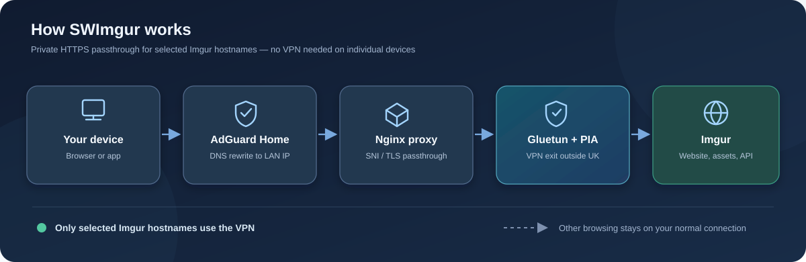

<!-- version 4.0.1 -->
<p align="center">
  
</p>

<h1 align="center">SWImgur — network-wide Imgur VPN proxy</h1><p align="center">
  <br>
  <strong>Access Imgur on your LAN using Private Internet Access (PIA), Gluetun, Nginx, Docker Compose and AdGuard Home — without installing a VPN on every device.</strong>
</p>

<p align="center">
  SWImgur uses AdGuard DNS rewrites to direct selected Imgur hostnames to an Nginx TCP proxy.<br>
  Nginx routes TLS connections through a PIA VPN via Gluetun, without decrypting HTTPS or requiring local TLS certificates.
</p>

<p align="center">
  📝 Original write-up: <a href="https://makes.swakes.co.uk/imgur-said-403-forbidden/">Imgur said 403 Forbidden</a>.
</p>

<p align="center">
  <sub>This is a community project, unaffiliated with Imgur, PIA, Gluetun or AdGuard.<br>
  Imgur may restrict particular VPN exit servers, and site availability is not guaranteed.</sub>
</p>


## How it works

<p align="center">
  
</p>

Only selected Imgur hostnames are routed through PIA. All other browsing uses the client's normal internet connection.

<br>

## Supported hostnames

| Hostname | Used for | Required for |
| :--- | :--- | :--- |
| **`imgur.com`** | Main website | Website |
| **`www.imgur.com`** | Website alias | Website |
| **`i.imgur.com`** | Hosted images | Images |
| **`s.imgur.com`** | JavaScript, CSS, fonts and static assets | Page rendering |
| **`api.imgur.com`** | Search, account features, feeds and API requests | Interactive features |

<br>
 
> [!IMPORTANT]
> **All five hostnames** must be in both the Nginx SNI allowlist **and** the AdGuard DNS rewrites for the full website to work. An HTTP `200` for the homepage does not prove that assets and API calls are working.

<br>

## Requirements

- Linux Docker host with Docker Engine and Compose plugin (ARM64 Raspberry Pi OS or x86_64)
- PIA subscription and **PIA VPN credentials** (these may differ from the website login)
- `/dev/net/tun` available
- AdGuard Home, Pi-hole or a similar DNS rewrite service used by LAN clients
- A wired interface supporting Docker macvlan, an unused LAN IP address, and the LAN subnet/gateway
- No conflicting device using the chosen address

<br>

## Installation

### 1. Clone and configure

```bash
# version 4.0.1
git clone https://github.com/pqpxo/imgur-proxy.git
cd imgur-proxy
cp .env.example .env
nano .env
chmod 600 .env
```

In `.env`, supply `PIA_USER`, `PIA_PASSWORD`, `SERVER_REGIONS`, `PROXY_IP` and `MACVLAN_NETWORK`. **Never commit .env**.

`PROXY_IP` is an unused address belonging to the **SWImgur container** on your LAN — it is not the Docker host or AdGuard's address. Reserve/exclude it from DHCP.

### 2. Create a macvlan network

Inspect your interface (`ip link`) and route (`ip route`). If you already have a suitable macvlan network, reuse it. Otherwise create one. **The following is a fictional example; replace all LAN values and the parent interface.**

```bash
# version 4.0.1
docker network create -d macvlan \
  --subnet=192.168.50.0/24 \
  --gateway=192.168.50.1 \
  -o parent=eth0 swimgur-macvlan
```

Set `MACVLAN_NETWORK=swimgur-macvlan` and a free address such as `PROXY_IP=192.168.50.200` in your private `.env` (only if those example values match your network). Linux hosts typically cannot access their own macvlan containers without a shim interface; test from another LAN device.

### 3. Deploy

```bash
# version 4.0.1
docker compose config --quiet
docker compose up -d --build
docker compose ps
docker compose logs --tail=60 vpn
```

The proxy waits for Gluetun's VPN health check before starting.

### 4. Configure AdGuard Home

Under **Filters → DNS rewrites**, point each hostname to **your `PROXY_IP`**:

| Domain | DNS Rewrite Target |
| :--- | :--- |
| `imgur.com` | **Your `PROXY_IP`** |
| `www.imgur.com` | **Your `PROXY_IP`** |
| `i.imgur.com` | **Your `PROXY_IP`** |
| `s.imgur.com` | **Your `PROXY_IP`** |
| `api.imgur.com` | **Your `PROXY_IP`** |

<br>

> [!TIP]
> Don't use a public secondary DNS server on clients that need these rewrites. Also check browser DNS-over-HTTPS, which may bypass AdGuard.
> Ensure devices actually use AdGuard rather than an alternative public DNS resolver or browser DNS-over-HTTPS. Verify IPv6 behaviour if relevant. **Never expose TCP 443 of the proxy to the public WAN.**

<br>

### 5. Test from another LAN machine

```bash
# version 4.0.1
nslookup imgur.com YOUR_ADGUARD_IP
curl -I --resolve imgur.com:443:YOUR_PROXY_IP https://imgur.com/
curl -I --resolve s.imgur.com:443:YOUR_PROXY_IP https://s.imgur.com/
curl -I --resolve api.imgur.com:443:YOUR_PROXY_IP https://api.imgur.com/
```

A successful TLS handshake and HTTP response prove forwarding; 302 redirects are sometimes expected. A 403/429 can indicate an Imgur-side restriction or rate limit on the VPN exit. The bare API root may also reject requests without the correct endpoint/client ID. Finally test an actual image and the website's Search, Sign in, and feeds.

Inspect the running Nginx configuration and the VPN exit:

```bash
# version 4.0.1
docker compose exec proxy nginx -T
docker compose exec proxy wget -qO- https://api.ipify.org
```

Do not post your real WAN IP publicly. A diagnostic helper is available in `scripts/check.sh`; the macvlan reachability portion should be run from a separate LAN machine.

<br>

## Updating and troubleshooting

**Nginx configuration is copied into the Docker image at build time. A plain container restart does not load new `nginx.conf` contents.** Rebuild and recreate:

```bash
# version 4.0.1
docker compose build --no-cache proxy
docker compose up -d --no-deps --force-recreate proxy
docker compose exec proxy nginx -t
```

For general image updates:

```bash
# version 4.0.1
docker compose pull vpn
docker compose build --pull proxy
docker compose up -d
```

| Symptom | What to check |
| :--- | :--- |
| **TLS handshake fails** | Check the hostname in the Nginx SNI allowlist, then **rebuild** the proxy image after updating `nginx.conf`. |
| **Regional restriction page** | Check client DNS servers, browser DoH, cached results and the actual connection destination. |
| **Blank Imgur page** | Confirm `s.imgur.com` reaches SWImgur and returns JS/CSS assets. |
| **Search, login or feeds fail** | Confirm `api.imgur.com` reaches SWImgur; inspect the browser Network tab for API `403` responses. |
| **HTTP 403 / 429 through VPN** | Imgur may be restricting or rate-limiting the chosen VPN exit IP. |
| **Docker host cannot reach proxy IP** | Normal macvlan host isolation; test from another LAN device. |
| **Startup DNS warnings** | Verify Gluetun recovers and its health status remains `healthy`. |

Avoid proxying random ad/tracker domains just because the browser lists blocked requests.

<br>

## Security and privacy

- Nginx forwards **TLS over TCP** by reading SNI and does not terminate/decrypt HTTPS.
- Only the five listed hostnames are forwarded. Unknown names are rejected.
- VPN egress uses Gluetun's network namespace and firewall; keep the proxy accessible only to trusted LAN clients.
- `.env`, Gluetun state and backups are ignored by Git and excluded from Docker build context.
- **Security notice for existing forks:** Older versions of this repository committed a `.env` file. Even after deleting it from the latest branch, those values may remain in Git history. Rotate any credentials that were present; consider purging sensitive history separately.

<br>

## Files

```text
imgur-proxy/
├── README.md
├── imgur_github.png
├── docker-compose.yml
├── Dockerfile
├── nginx.conf
├── .env.example
├── .gitignore
├── .dockerignore
├── scripts/check.sh
└── LICENSE
```

## License

MIT — see [LICENSE](LICENSE).
